<!--suppress HtmlDeprecatedAttribute, HttpUrlsUsage -->

<div align="center">
  <p>
    <picture>
      <source srcset="https://github.com/SuperMonster003/AutoJs6-Plugin-Three-Chime-Alarm/blob/master/app/src/main/res/mipmap-night/ic_launcher.png?raw=true" media="(prefers-color-scheme: dark)" />
      
    </picture>
  </p>

  <p>鬧鐘, 計時器與碼錶, 支援日曆重複規則與節假日, 朗讀響鈴與響鈴時連動指令碼</p>

  <p>
    <a href="https://github.com/SuperMonster003/AutoJs6-Plugin-Three-Chime-Alarm/releases"></a>
    <a href="https://github.com/SuperMonster003/AutoJs6-Plugin-Three-Chime-Alarm/issues"></a>
    <a href="https://github.com/SuperMonster003/AutoJs6-Plugin-Three-Chime-Alarm/blob/master/LICENSE"></a>
  </p>
</div>

******

### 語言 (Languages)

******

目前 README.md 支援以下語言:

- [简体中文 [zh-Hans]](https://github.com/SuperMonster003/AutoJs6-Plugin-Three-Chime-Alarm/blob/master/.readme/README-zh-Hans.md)
- [繁體中文 (香港) [zh-Hant-HK]](https://github.com/SuperMonster003/AutoJs6-Plugin-Three-Chime-Alarm/blob/master/.readme/README-zh-Hant-HK.md)
- 繁體中文 (台灣) [zh-Hant-TW] # 目前
- [English [en]](https://github.com/SuperMonster003/AutoJs6-Plugin-Three-Chime-Alarm/blob/master/.readme/README-en.md)
- [Français [fr]](https://github.com/SuperMonster003/AutoJs6-Plugin-Three-Chime-Alarm/blob/master/.readme/README-fr.md)
- [Español [es]](https://github.com/SuperMonster003/AutoJs6-Plugin-Three-Chime-Alarm/blob/master/.readme/README-es.md)
- [日本語 [ja]](https://github.com/SuperMonster003/AutoJs6-Plugin-Three-Chime-Alarm/blob/master/.readme/README-ja.md)
- [한국어 [ko]](https://github.com/SuperMonster003/AutoJs6-Plugin-Three-Chime-Alarm/blob/master/.readme/README-ko.md)
- [Русский [ru]](https://github.com/SuperMonster003/AutoJs6-Plugin-Three-Chime-Alarm/blob/master/.readme/README-ru.md)
- [العربية [ar]](https://github.com/SuperMonster003/AutoJs6-Plugin-Three-Chime-Alarm/blob/master/.readme/README-ar.md)

******

### 簡介

******

3-Chime Alarm 是 AutoJs6 的鬧鐘外掛, 也是不安裝 AutoJs6 也能獨立使用的鬧鐘應用程式. 鬧鐘按 RFC 5545 日曆規則重複 (例如每月最後一個星期五, 或從某天起每隔 3 天), 響鈴時可以朗讀文字, 也可以啟動指令碼或通知正在執行的指令碼. 1.1.0 起也提供多個同時執行的計時器與一個碼錶. 1.2.0 起鬧鐘可以在節假日不響, 只在節假日響, 或在每個工作日 (包括調整放假的補班日) 響, 指令碼也可以在響鈴前決定這一次響不響. 關閉挑戰將在後續版本加入.

外掛使用 Android 精確鬧鐘自行排程並響鈴, 因此 AutoJs6 沒有執行時鬧鐘也會準時響. AutoJs6 指令碼透過全域模組 `alarms` 查詢, 新增, 修改與監聽外掛中的鬧鐘, 透過 `alarms.timers` 與 `alarms.stopwatch` 使用計時器與碼錶; 子命名空間 `alarms.system` 直接呼叫系統時鐘應用程式, 未安裝外掛時也能使用. 外掛也可以接收其他應用程式發出的設定鬧鐘與計時器要求.

> 1.2.0 提供鬧鐘 (包括節假日規則與響鈴前由指令碼決定), 計時器與碼錶, 外掛介面, 外掛工具與 `alarms` 指令碼模組. 在外掛中心啟用本外掛, 使用外掛工具與 `alarms` 模組需要 AutoJs6 6.8.1 (內部版本號 6641) 或更新版本; 在較早的 AutoJs6 上 (包括 6.8.0), 外掛只能作為獨立的鬧鐘應用程式使用. 關閉挑戰的進度見開發路線圖.

******

### 功能亮點

******

- 鬧鐘: 單次或重複鬧鐘. 重複規則支援工作日, 每月第幾個星期幾, 月底, 間隔天數, 截止日期與次數, 也可以排除指定日期或只略過下一次響鈴.
- 響鈴: 系統鈴聲或匯入的本機音訊, 朗讀文字, 獨立音量與漸強, 自訂震動, 貪睡與自動停止, 鎖定時顯示全螢幕響鈴畫面; 多個鬧鐘同時到期時依序響鈴.
- 準時可靠: 裝置重新開機, 修改時間或時區, 外掛升級後自動重新排程, 開機後未解鎖也會響鈴; 關機錯過的鬧鐘在 5 分鐘內補響, 超過則留下一則通知.
- 指令碼連動: 鬧鐘與計時器可以登記指令碼檔案, 響鈴, 貪睡, 關閉等事件發生時由 AutoJs6 啟動, 指令碼不必常駐; 正在執行的指令碼也可以即時監聽這些事件.
- 外掛工具: 經 MCP Server 外掛或 `plugins.tools.call` 新增, 查詢, 修改與刪除鬧鐘, 處理正在響的鬧鐘, 開始, 檢視與控制計時器, 查詢節假日 (9 個 `alarm_*` 工具, 3 個 `timer_*` 工具與 `holiday_check`).
- 系統時鐘對接: 可以處理其他應用程式發出的設定, 顯示, 關閉與貪睡鬧鐘要求, 以及設定, 顯示與關閉計時器要求.
- 介面: 語言, 深色模式與主題色預設跟隨 AutoJs6, 也可以單獨設定; 可以切換啟動器圖示; 設定頁可以設定鈴聲, 震動, 貪睡與自動停止的預設值.
- 計時器與碼錶: 最多 20 個計時器同時執行, 可以暫停, 繼續, 延長時間與重設; 執行中的計時器在通知欄顯示倒數, 可以直接暫停, 加 1 分鐘或取消; 重新開機後繼續計時, 時間到時與鬧鐘一樣響鈴. 碼錶支援分圈 (最多 100 圈), 標出最快與最慢的一圈. 底部導覽列在鬧鐘, 計時器與碼錶之間切換.
- 節假日: 鬧鐘可以選 "節假日不響", "只在節假日響" 或 "只在工作日響" (每個工作日都響, 包括補班日, 週末與節假日不響). 內建 250 個國家和地區 (包括 600 多個下級地區) 2020 - 2035 年的資料, 由開放原始碼專案 python-holidays 產生; 每週自動檢查更新, 下載的資料經簽章驗證. 尚未公布的年份依規則推算並標為 "推算", 某年沒有資料時只依重複規則響.
- 響鈴前由指令碼決定: 登記的指令碼在響鈴前 (預設 60 秒, 可設 15 秒至 5 分鐘) 由 AutoJs6 啟動, 可以略過這一次, 或照常響鈴並臨時改用其他標籤, 鈴聲, 朗讀文字或震動; 指令碼沒有及時決定, 發生錯誤或 AutoJs6 無法使用時照常響鈴.
- 關閉挑戰 (1.3.0 規劃): 算術題, 搖一搖, 照打一句話或指令碼條件, 都帶安全閥, 確保鬧鐘總能被關閉.

******

### 螢幕截圖

******

螢幕截圖來自 Sony XQ-DQ72, 上排為淺色主題, 下排為深色主題.

| 鬧鐘清單 | 編輯鬧鐘 | 響鈴 | 設定 |
| :---: | :---: | :---: | :---: |
| 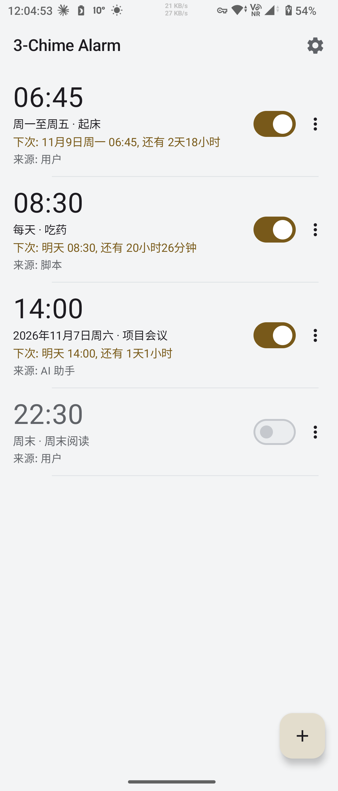 | 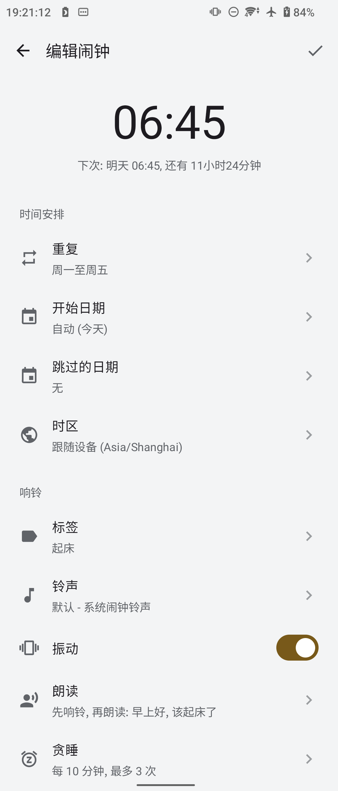 | 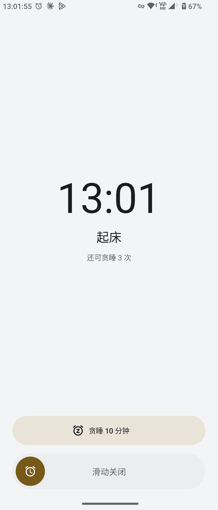 | 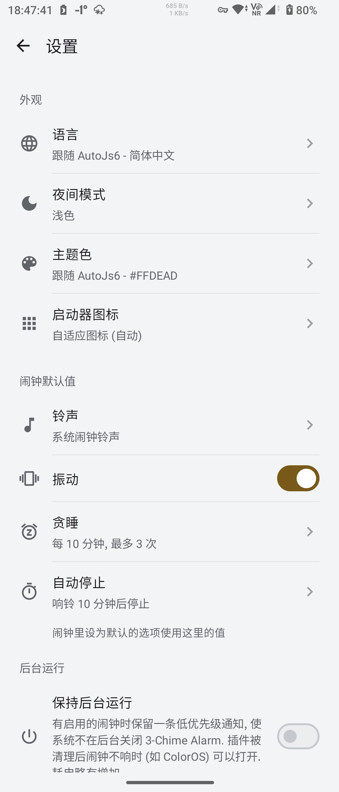 |
| 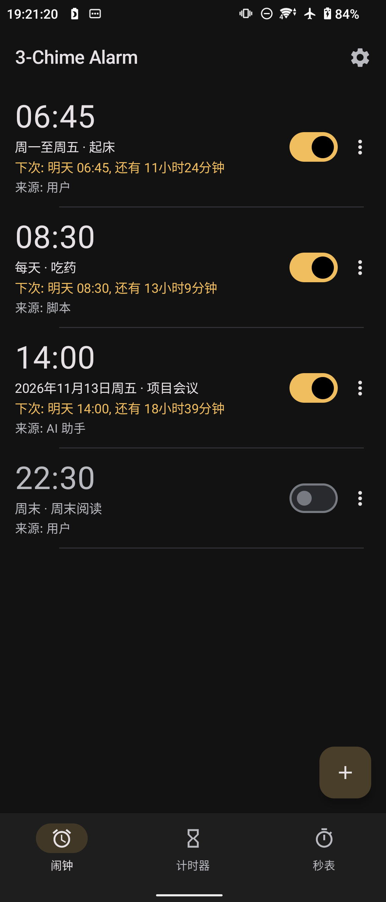 | 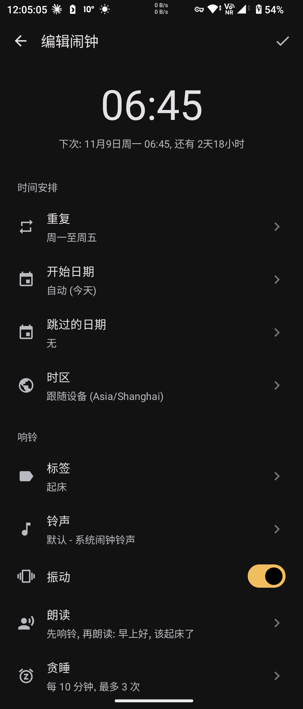 | 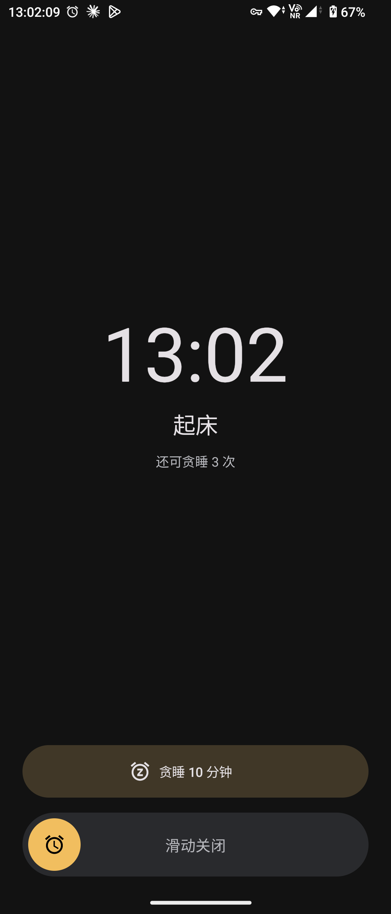 | 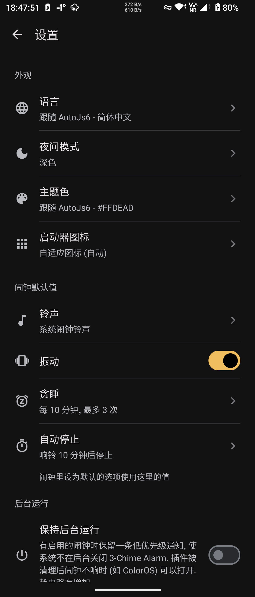 |

| 計時器 | 碼錶 |
| :---: | :---: |
| 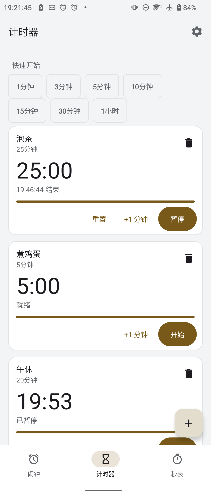 | 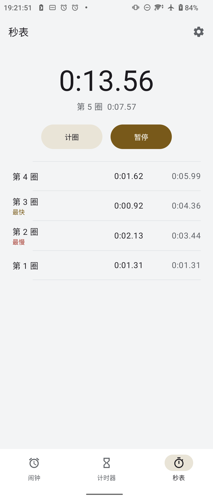 |
| 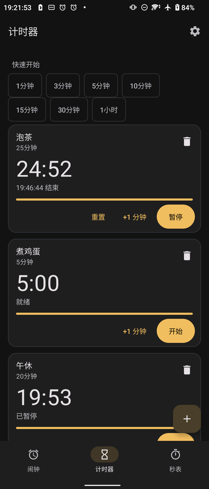 | 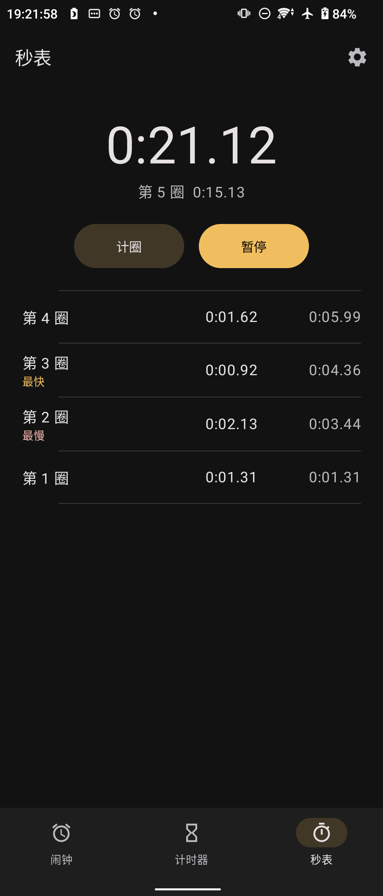 |

******

### 使用方法

******

1. 從 [Releases](https://github.com/SuperMonster003/AutoJs6-Plugin-Three-Chime-Alarm/releases) 下載 APK 並安裝. 安裝套件不區分 ABI, 適用於所有裝置.
2. 開啟外掛, 在權限頁逐項處理: 通知, 精確鬧鐘 (Android 12 與 12L 需要手動允許), 全螢幕提醒 (Android 14 起可能未授予), 以及電池最佳化, 背景限制與廠商自啟動. 之後就可以像一般時鐘應用程式一樣使用.
3. 若要在指令碼中使用 `alarms` 模組或使用外掛工具, 請將 AutoJs6 升級到 6.8.1 (內部版本號 6641) 或更新版本, 並在外掛中心啟用本外掛 (安裝精靈的 "工具" 分類).

> 外掛支援 Android 7.0 (API 24) 以上的裝置. 只有一個適用於所有裝置的安裝包; 其中唯一的原生程式庫來自介面框架 Compose, 已按 16 KB 記憶體分頁對齊, 在 16 KB 記憶體分頁的裝置上也能執行.

******

### 腳本 API

******

指令碼透過全域模組 `alarms` (也可寫作 `$alarms`, 僅 Rhino) 使用這些功能, 完整說明見 [AutoJs6 文件](https://docs.autojs6.com/#/alarms):

```javascript
let a = alarms.add({ time: "07:30", repeat: "FREQ=WEEKLY;BYDAY=MO,TU,WE,TH,FR", label: "Wake up" });
a.bind("./after-wake.js", { events: ["dismiss"] });

alarms.add({ time: "18:00", repeat: "FREQ=MONTHLY;BYDAY=-1FR", label: "Monthly report" });
alarms.add({ time: "06:10", date: "2026-11-04", repeat: { freq: "daily", interval: 3 }, tag: "shift" });

let w = alarms.add({ time: "07:30", holidays: { region: "CN", mode: "workdays" }, label: "Work" });
w.bind("./weather-check.js", { events: ["beforeRing"], leadSeconds: 120 });

alarms.on("ring", (e) => toast(e.label));

alarms.timers.start("25m", { label: "Tea" });

alarms.system.setAlarm({ hour: 6, minute: 50, label: "Flight" });
```

- `alarms.add(options)` 新增鬧鐘並傳回鬧鐘快照; `alarms.list`, `get`, `update`, `remove`, `setEnabled`, `skipNext` 與 `cancelSkip` 管理外掛中的所有鬧鐘, 包括在外掛介面建立的鬧鐘.
- `repeat` 接受 RRULE 字串 (例如 `FREQ=MONTHLY;BYDAY=-1FR`), 星期編號陣列或結構化物件; `alarms.preview(options)` 列出接下來的響鈴時間, 方便核對規則.
- `alarms.bind(id, script, options)` (或鬧鐘快照的 `bind`) 登記指令碼, 事件發生時由 AutoJs6 啟動, 事件資料可透過 `alarms.currentEvent()` 讀取; `alarms.on('ring', listener)` 在指令碼執行期間即時監聽.
- `alarms.ringing`, `dismiss` 與 `snooze` 處理正在響的鬧鐘; `alarms.ringtones.list()` 列出可用的鈴聲.
- `alarms.timers.start(duration, options)` 開始計時器 (時長為毫秒數或 `"25m"`, `"1h 30m"` 這樣的字串, 1 秒至 100 小時), 傳回帶有 `pause`, `resume`, `addTime`, `reset`, `cancel` 與 `bind` 方法的計時器快照; `alarms.stopwatch` 提供碼錶的開始, 暫停, 繼續, 分圈與重設. 兩者都需要外掛 1.1.0 或更新版本.
- `alarms.holidays` 查詢節假日資料 (`regions`, `isHoliday`, `isWorkday`, `list`, `info`, `refresh`); 鬧鐘的 `holidays` 選項 (例如 `{ region: 'CN', mode: 'workdays' }`) 設定節假日規則, `alarms.capabilities()` 的 `warnings` 提示缺少資料或推算年份. 需要外掛 1.2.0 或更新版本.
- `alarms.bind(id, script, { events: ['beforeRing'], leadSeconds: 120 })` 登記在響鈴前啟動的指令碼, 指令碼中 `alarms.currentEvent()` 的 `skip(reason)` 略過這一次, `ring(overrides)` 照常響鈴並臨時改用其他標籤, 鈴聲, 朗讀或震動; `alarms.on('beforeRing', listener)` 即時監聽, 事件物件同樣有這兩個方法. 需要外掛 1.2.0 或更新版本.
- `alarms.system` 直接呼叫系統時鐘應用程式 (`setAlarm`, `setTimer`, `showAlarms`, `dismissAlarm`, `next` 等), 不需要安裝外掛.

******

### 系統時鐘對接

******

外掛可以作為系統的鬧鐘應用程式, 處理其他應用程式 (例如日曆, 語音助理與自動化工具) 發出的標準時鐘要求. 發出要求的應用程式需要持有 `com.android.alarm.permission.SET_ALARM` 權限:

- 設定鬧鐘 (`SET_ALARM`): 讀取時間, 標籤, 星期, 震動與鈴聲; 要求略過介面時直接儲存, 否則開啟預先填好的編輯頁.
- 顯示鬧鐘 (`SHOW_ALARMS`): 開啟鬧鐘清單.
- 關閉鬧鐘 (`DISMISS_ALARM`): 結束正在響或貪睡中的鬧鐘; 沒有正在響的鬧鐘時, 24 小時內要響的鬧鐘改為略過這一次; 符合多個鬧鐘時由使用者選擇.
- 貪睡 (`SNOOZE_ALARM`): 讓正在響的鬧鐘貪睡.
- 設定計時器 (`SET_TIMER`): 讀取時長 (1 秒至 100 小時) 與標籤並開始計時器; 已有時長與標籤都相同且已重設的計時器時重新開始它; 要求沒有略過介面時同時開啟計時器頁, 沒有時長時開啟新增計時器對話方塊.
- 顯示計時器 (`SHOW_TIMERS`): 開啟計時器頁.
- 關閉計時器 (`DISMISS_TIMER`): 結束正在響的計時器, 不影響仍在計時的計時器.
- 方向相反的 `alarms.system`: 指令碼用它把要求傳給系統預設的時鐘應用程式 (本外掛或其他時鐘應用程式), 不需要安裝外掛; 各品牌時鐘應用程式的差異見 AutoJs6 文件.

******

### 相容性

******

外掛支援 Android 7.0 (API 24) 以上. 在外掛中心啟用本外掛, 使用外掛工具與 `alarms` 模組需要 AutoJs6 6.8.1 (內部版本號 6641) 或更新版本. 在較早的 AutoJs6 上 (例如內部版本號為 6640 的 6.8.0), 外掛中心提示需要更新版本的 AutoJs6 且不能啟用本外掛, 外掛工具與 `alarms` 模組無法使用, 但外掛仍可作為獨立的鬧鐘應用程式使用, 也照常處理系統時鐘要求. `alarms` 模組只支援 Rhino 引擎, 其中的 `alarms.system` 不需要安裝外掛.

1.0.0 發布前在以下裝置上完成驗證 (數據見開發路線圖附錄 D); 1.1.0 的計時器與碼錶另在 Sony XQ-AT72 與 Sony G8441 上驗證, 包括重新開機後繼續計時 (見開發路線圖 P7); 1.2.0 的節假日與響鈴前由指令碼決定在 Sony XQ-AT72 上與 AutoJs6 聯合驗證 (見開發路線圖 P8):

| 裝置 | Android | 結果 |
| --- | --- | --- |
| Sony XQ-AT72 | 12 (API 31) | 通過: 到點偏差中位數 44 ms; 鎖定畫面響鈴, 重新開機後到點響鈴, 修改時間, 時區與日光節約時間, 經 MCP Server 呼叫外掛工具 |
| Sony XQ-DQ72 | 13 (API 33) | 通過: 到點偏差中位數 13 ms; 鎖定畫面全螢幕響鈴, 處理程序被清理後到點約 1.1 秒顯示響鈴畫面 |
| Redmi 22120RN86C (MIUI) | 13 (API 33) | 通過: 到點偏差中位數 40 ms; 開機後系統多次結束外掛處理程序, 到點仍準時響鈴 |
| Xiaomi Pad 23046RP50C | 15 (API 35) | 通過: 到點偏差中位數 32 ms; 未授予全螢幕提醒時以浮動通知響鈴, 重新開機後未解鎖也準時響鈴 |
| OnePlus OPD2413 (ColorOS 15) | 15 (API 35) | 通過 (需開啟自動啟動): 到點偏差中位數 23 ms; 在 設定 > 應用程式 > 自動啟動 中開啟後, 處理程序被清理也準時響鈴 (見常見問題) |
| Sony G8441 | 9 (API 28) | 通過: 到點偏差中位數 41 ms; 鎖定畫面響鈴, 重新開機後未解鎖也準時響鈴 |
| Android 模擬器 | 7.0 - 16 (API 24 - 36) | 通過: 最低版本完整流程, 首次解鎖前響鈴, 16 KB 記憶體分頁 |

******

### 常見問題

******

#### 不安裝 AutoJs6 能用嗎?

能. 外掛內建完整的鬧鐘介面, 可以獨立當作鬧鐘應用程式使用. 只有在指令碼需要管理鬧鐘, 連動指令碼或使用外掛工具時才用到 AutoJs6.

#### AutoJs6 沒有執行時鬧鐘還會響嗎?

會. 鬧鐘由外掛透過 Android 精確鬧鐘排程並響鈴, 不依賴 AutoJs6 處理程序. 登記了指令碼時, 外掛在響鈴時喚醒 AutoJs6 啟動該指令碼.

#### 為什麼 AutoJs6 6.8.0 的外掛中心不能啟用本外掛?

外掛中心啟用本外掛, 外掛工具與 `alarms` 模組需要 AutoJs6 6.8.1 (內部版本號 6641) 或更新版本, 而 6.8.0 的內部版本號為 6640. 升級 AutoJs6 後即可啟用; 在此之前外掛可以作為獨立的鬧鐘應用程式使用.

#### 鬧鐘沒有準時響, 應該檢查什麼?

先開啟外掛的權限頁, 確認通知與精確鬧鐘已允許, 並依頁面說明關閉電池最佳化, 解除背景限制, 允許自啟動. 零打擾模式預設允許鬧鐘, 若改過零打擾設定, 請確認鬧鐘仍被允許. 關機或系統延後導致錯過的鬧鐘, 5 分鐘內會補響, 超過則不響並留下一則通知.

#### OPPO, 一加, realme (ColorOS) 上鬧鐘不響怎麼辦?

ColorOS 有兩處互相獨立的開關, 都要為 3-Chime Alarm 開啟: 應用程式資訊中的 "允許自動啟動" / "關聯啟動" / "背景活動", 以及 設定 > 應用程式 > 自動啟動 清單. 只開前者時, 外掛處理程序被清理 (例如在最近使用的應用程式中滑掉) 後, 系統會攔下到點的鬧鐘. 連動指令碼時 AutoJs6 也要在兩處開啟. 另外請不要在最近使用的應用程式中滑掉外掛, 可以把它鎖定. 外掛權限頁在 ColorOS 上有對應的引導列; 設定頁的 "保持背景執行" 會常駐一則靜音通知, 進一步減少外掛被清理的機會, 耗電略有增加.

#### ColorOS 上鎖定畫面響鈴時只有鈴聲和通知, 沒有跳出響鈴畫面?

ColorOS 新安裝應用程式的 "橫幅" 通知預設關閉, 系統因此不顯示全螢幕響鈴畫面. 在外掛的通知設定中開啟 "橫幅" 即可, 權限頁的 "橫幅通知" 一列可以直達該設定; 也可以在權限頁允許 "懸浮視窗" 作為備援.

#### 強制停止外掛後鬧鐘不響了?

"強制停止" 會讓系統清除外掛的所有鬧鐘排程, 停止期間到點不響, 這是 Android 的規則. 從啟動器開啟一次外掛即可恢復排程; 恢復時仍在 5 分鐘內的鬧鐘會補響.

#### 小米 (MIUI, HyperOS) 需要特別設定嗎?

實測 Redmi (MIUI) 在開機後會多次結束外掛處理程序, 到點時系統仍會啟動外掛並準時響鈴. 仍建議依權限頁的說明設定自啟動與省電策略.

#### 裝置重新開機後還沒解鎖, 鬧鐘會響嗎? 連動的指令碼呢?

鬧鐘會響, 外掛在首次解鎖之前也能執行. 連動的指令碼不會啟動, 因為 AutoJs6 在首次解鎖之前不能執行指令碼, 解鎖後也不會補啟動.

#### 裝置重新開機後, 計時器和碼錶會怎樣?

計時器按關機前的到期時刻繼續計時, 關機期間也計算在內. 關機期間已到期的計時器, 開機時逾時不到 5 分鐘的會補響, 超過 5 分鐘的留下一則錯過的通知. 開機後系統校正時間時, 到期時刻可能隨之移動幾秒. 碼錶重新開機後轉為暫停, 讀數計到本次開機為止, 因此會多計關機的那段時間 (重新開機通常不到 1 分鐘).

#### 節假日資料準確嗎? 補班日會響嗎?

節假日與補班日是否準確完全取決於上游資料 (開放原始碼專案 python-holidays). 選 "只在工作日響" 時補班日會響; 選 "節假日不響" 時只依重複規則判斷 (例如星期一至五的鬧鐘在星期六的補班日不響). 尚未公布的年份依規則推算, 設定頁與編輯頁會標出 "推算", 公布後隨資料更新修正; 資料每週自動檢查一次, 也可以在設定頁手動檢查.

#### `beforeRing` 指令碼來不及決定會怎樣?

照常響鈴. 決定的截止時刻預設為響鈴前 5 秒; 到時仍沒有決定, 指令碼發生錯誤, AutoJs6 無法使用 (例如被強制停止) 或重新開機後尚未解鎖時, 鬧鐘都照常響鈴. 已被節假日規則略過的那一次不會啟動 `beforeRing` 指令碼.

******

### 權限與安全

******

外掛申請的權限與用途:

- 精確鬧鐘 (`USE_EXACT_ALARM`, Android 12 與 12L 為 `SCHEDULE_EXACT_ALARM`): 準時響鈴. Android 13 起安裝即授予, Android 12 與 12L 需要在系統設定中允許 "鬧鐘與提醒".
- 通知 (`POST_NOTIFICATIONS`): 顯示正在響的鬧鐘與錯過的鬧鐘, 以及執行中的計時器與碼錶. 缺少時鬧鐘與計時器照常發聲, 但沒有通知與響鈴畫面.
- 全螢幕提醒 (`USE_FULL_SCREEN_INTENT`): 在鎖定畫面顯示響鈴畫面. Android 14 起可能未授予, 缺少時以浮動通知響鈴.
- 懸浮視窗 (`SYSTEM_ALERT_WINDOW`, 選用): 系統不顯示全螢幕提醒時 (例如 ColorOS 的橫幅通知關閉) 用來開啟響鈴畫面, 只在權限頁由使用者視需要允許.
- 開機啟動 (`RECEIVE_BOOT_COMPLETED`): 重新開機後重新排程, 首次解鎖前也能響鈴.
- 前景服務 (`FOREGROUND_SERVICE`, `FOREGROUND_SERVICE_SYSTEM_EXEMPTED`): 響鈴期間保持發聲; 設定頁的 "保持背景執行" 開啟時也用它常駐 (預設關閉).
- 震動, 喚醒鎖定與音訊設定 (`VIBRATE`, `WAKE_LOCK`, `MODIFY_AUDIO_SETTINGS`): 震動, 響鈴時保持裝置喚醒, 以及獨立的鬧鐘音量在響鈴後還原.
- 重新排序執行中的應用程式 (`REORDER_TASKS`, 僅 Android 7.0 - 8.1): 其他應用程式或指令碼幾乎同時發出多個鬧鐘要求時, 把系統沒有啟動的要求調到前景處理, 讓每個要求都得到處理. 安裝時即授予.
- 網路 (`INTERNET`, `ACCESS_NETWORK_STATE`): 只用於更新檢查與節假日資料更新. 更新檢查在開啟鬧鐘清單時依設定的頻率進行, 節假日資料每週檢查一次, 兩者在計量付費網路上預設都不檢查; 排程, 響鈴與 AutoJs6 連動從不連網.
- AutoJs6 外掛權限 (`org.autojs.permission.PLUGIN`): 與 AutoJs6 通訊.

外掛在設計上盡量縮小權限範圍:

- 受保護的入口: 能力服務與啟用入口受 AutoJs6 外掛權限 (`org.autojs.permission.PLUGIN`) 保護, 其他應用程式無法直接呼叫; 接收系統時鐘要求的入口要求呼叫端持有 `com.android.alarm.permission.SET_ALARM`.
- 網路: 只用於檢查外掛更新與節假日資料 (連線到 GitHub, 兩者的自動檢查都可在設定頁關閉), 下載的節假日資料經簽章驗證, 不上傳鬧鐘或任何個人資料.
- 儲存空間: 鬧鐘儲存在外掛私有目錄, 不參與雲端備份; 本機鈴聲透過系統檔案選擇器匯入, 不申請儲存權限.
- 指令碼權限: 指令碼可以透過 `alarms` 模組讀寫外掛中的所有鬧鐘與計時器, 包括在外掛介面建立的鬧鐘與計時器; 登記的指令碼儲存在 AutoJs6 中, 外掛介面只標記鬧鐘有指令碼綁定並可以解除.

******

### 外掛介面

******

以下資訊面向 AutoJs6 主程式與外掛開發者, 主程式透過這些識別碼發現外掛並完成能力協商:

```text
application id: io.github.supermonster003.autojs6.plugin.three.chime.alarm
plugin id: three-chime-alarm
engine: alarm
variant: default
info service: org.autojs.plugin.INFO (category three-chime-alarm)
capability service: org.autojs.plugin.ALARM (category alarm)
wake action: org.autojs.plugin.action.WAKE
minimum host build: 6641
native libraries: libandroidx.graphics.path.so only (Compose graphics-path, 4 ABIs, uncompressed, 16 KB aligned; a single APK for every ABI)
```

******

### 開發路線圖

******

功能規劃, 設計決策與完成情況以可勾選清單維護在 ROADMAP.md 中. 未勾選的項目表示規劃意向, 不代表目前版本的能力.

- [檢視 ROADMAP.md](https://github.com/SuperMonster003/AutoJs6-Plugin-Three-Chime-Alarm/blob/master/ROADMAP.md)

******

### 發行歷史

******

#### v1.2.0

_2026/11/13_

- `提示` 指令碼中的 alarms.holidays, 鬧鐘的 holidays 選項與 beforeRing 事件需要 AutoJs6 6.8.1 (內部版本號 6641) 或更新版本, 並需要本外掛 1.2.0 或更新版本; 外掛仍為 1.1.x 或更早時呼叫會發生錯誤並提示更新外掛
- `提示` 節假日與補班日是否準確完全取決於上游資料 (開放原始碼專案 python-holidays); 尚未公布的年份依規則推算並標為 "推算", 公布後隨資料更新修正
- `新增` 節假日: 鬧鐘新增 "節假日不響", "只在節假日響" 與 "只在工作日響" 三種選項 (只在工作日響即每個工作日都響, 包括補班日, 週末與節假日不響); 內建 250 個國家和地區 (包括 600 多個下級地區) 2020 - 2035 年的節假日資料, 中國大陸與臺灣包括補班日
- `新增` 設定頁可以選擇預設節假日地區 (首次依系統地區推斷), 每個鬧鐘也可以個別指定地區; 鬧鐘清單顯示下一次響鈴略過了幾個節假日; 推算的年份標為 "推算", 提示可能有調整放假或補班
- `新增` 節假日資料每週自動檢查更新 (可在設定頁關閉, 預設不在計量網路上下載), 也可以在設定頁手動檢查; 下載的資料經簽章驗證, 未通過時繼續使用原有資料; 某年沒有資料時鬧鐘只依重複規則響, 不會因此不響
- `新增` 響鈴前由指令碼決定 (beforeRing): 登記的指令碼在響鈴前 (預設 60 秒, 可設 15 秒至 5 分鐘) 被喚起, 可以略過這一次, 或照常響鈴並臨時改用其他標籤, 鈴聲, 朗讀文字或震動; 指令碼沒有及時決定, 發生錯誤或 AutoJs6 無法使用時照常響鈴
- `新增` AutoJs6 指令碼模組新增 alarms.holidays (查詢地區, 判斷節假日與工作日, 列出全年節假日, 檢視與更新資料), 鬧鐘的 holidays 選項與 beforeRing 事件的 skip / ring, alarms.capabilities() 新增 warnings 提示缺少資料或推算年份 (需要 AutoJs6 6.8.1; 參閱 [AutoJs6 文件](https://docs.autojs6.com/#/alarms))
- `新增` 外掛工具新增 holiday_check, 可經 MCP Server 外掛或 plugins.tools.call 查詢某天在某地區是否為節假日或工作日及節假日名稱; alarm_add 與 alarm_update 支援 holidays 選項

#### v1.1.0

_2026/11/12_

- `提示` 指令碼中的 alarms.timers 與 alarms.stopwatch 需要 AutoJs6 6.8.1 (內部版本號 6641) 或更新版本, 並需要本外掛 1.1.0 或更新版本; 外掛仍為 1.0.x 時呼叫會發生錯誤並提示更新外掛
- `新增` 計時器: 最多 20 個計時器同時執行, 時長可以選預設 (1 分鐘至 1 小時) 或自訂 (1 秒至 100 小時), 可以加標籤, 可以暫停, 繼續, 加 1 分鐘與重設; 時間到時與鬧鐘一樣響鈴
- `新增` 執行中的計時器在通知欄顯示倒數, 可以直接在通知上暫停, 加 1 分鐘或取消; 裝置重新開機後計時器繼續計時, 關機期間到期的計時器在開機後補響 (逾時超過 5 分鐘的只留下一則錯過的通知)
- `新增` 碼錶: 開始, 暫停, 繼續與重設, 最多記錄 100 圈, 標出最快與最慢的一圈; 執行時在通知欄顯示, 可以在設定頁的 "計時器與碼錶" 分組中關閉
- `新增` 底部導覽列在鬧鐘, 計時器與碼錶三個頁面之間切換
- `新增` AutoJs6 指令碼模組新增 alarms.timers 與 alarms.stopwatch (需要 AutoJs6 6.8.1): 開始, 查詢, 暫停, 繼續, 加減時間, 重設與取消計時器, 為計時器登記在響鈴等事件發生時啟動的指令碼, 控制碼錶並記錄分圈 (參閱 [AutoJs6 文件](https://docs.autojs6.com/#/alarms))
- `新增` 外掛工具新增 timer_start, timer_list 與 timer_control, 可經 MCP Server 外掛或 plugins.tools.call 開始, 檢視, 暫停, 繼續, 延長, 重設與取消計時器
- `新增` 系統時鐘對接新增計時器要求: 其他應用程式可以讓外掛開始計時器, 開啟計時器頁或關閉正在響的計時器

#### v1.0.1

_2026/11/08_

- `修復` 其他應用程式或 AutoJs6 指令碼很快地連續發出兩個同類的鬧鐘要求 (例如連續兩次新增鬧鐘, 或連續呼叫 alarms.system.setAlarm 並指定本外掛) 時, 如果外掛當時沒有開啟的畫面, 第二個要求會被忽略, 鬧鐘沒有建立, 也沒有任何提示; 現在每個要求都會處理; 在 Android 7.0 - 8.1 上, 為此需要 "重新排序執行中的應用程式" 權限 (安裝時自動授予)

##### 更多發行歷史可參閱

* [CHANGELOG.md](https://github.com/SuperMonster003/AutoJs6-Plugin-Three-Chime-Alarm/blob/master/app/src/main/assets/doc/CHANGELOG-zh-Hant-TW.md)

******

### 建置

******

本節面向希望從原始碼建置外掛的開發者.

```powershell
.\gradlew.bat :app:assembleDebug :app:testDebugUnitTest
.\gradlew.bat :app:appendDigestToReleasedFiles
py .python\generate_markdown.py --check
py .python\generate_icon_studio.py --check
py .python\check_repository.py
```

******

### 授權

******

專案程式碼採用 [Mozilla Public License 2.0](https://github.com/SuperMonster003/AutoJs6-Plugin-Three-Chime-Alarm/blob/master/LICENSE). 第三方元件與資料的授權見第三方聲明. 節假日資料由開放原始碼專案 python-holidays (MIT 授權) 產生, 授權全文與貢獻者名單隨資料一同發布.

- [第三方聲明 (THIRD_PARTY_NOTICES.md)](https://github.com/SuperMonster003/AutoJs6-Plugin-Three-Chime-Alarm/blob/master/THIRD_PARTY_NOTICES.md)

******

### 相關連結

******

- AutoJs6 專案: https://github.com/SuperMonster003/AutoJs6
